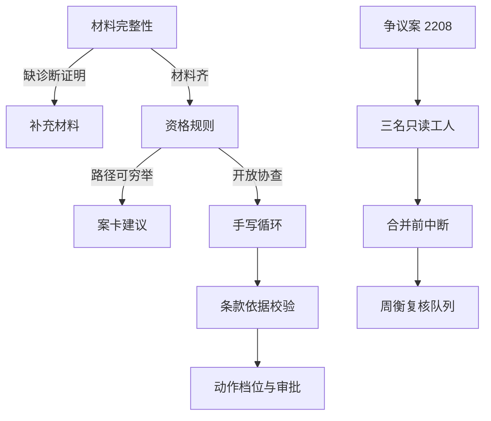

# 核赔台

核赔台是安澜财险成都理赔中心的协查建议服务，产品只做「安康住院2024」。下面按能力增量记录设计约束和验收。

仓库里 `claimdesk/` 已有前 20 天的实现骨架，`tests/test_day01_scope.py` 到 `tests/test_day20_trace.py` 是对应验收。日课按「从零把这个文件写出来」来写。你对着路径实现；已经存在的文件当作参考答案，先读测试再改实现。第 21 天起的测试和模块日课里会指定路径，需要你自己新建。

标了 **[亲手]** 的自己写。标了 **[AI]** 的，你先把约束写清楚再生成：案子标签、条款号、红线、工具副作用、状态机、审批档位不要让它改。生成之后跑当天的 pytest，看断言，看失败时的输入。

每天结束至少一次 commit，提交信息以 `dayN:` 开头。

智能体技能怎样落成可调用、可恢复、副作用不重复的服务，见 [为什么招智能体工程师常要后端经验.md](为什么招智能体工程师常要后端经验.md)。存储、队列、缓存和审计用 SQLite，HTTP 用 FastAPI，容器只在第 30 天出现。

---

## 1. 工具

| 工具 | 用途 |
|---|---|
| Python 3.12 | 开发与镜像使用的版本。项目 `requires-python` 是 `>=3.11`。 |
| pytest | 每天的验收 |
| Pydantic 2 | 工具参数契约 |
| FastAPI | 第 3 天起的 HTTP 接口。测试用 `TestClient`，不占端口 |
| SQLite | 案件、队列、幂等、缓存、审计、用量。标准库 `sqlite3`，测试用临时文件 |
| rank-bm25 | 第 7 天起的关键词检索 |
| LangGraph | 只在第 19 天的争议合并图里使用 |
| Git | 每天一次 commit |

```bash
./scripts/test.sh                    # 自动建 .venv、安装、跑全部 tests
./scripts/test.sh tests/test_day01_scope.py   # 只跑某一天

# 或手动：
python3.12 -m venv .venv
source .venv/bin/activate
pip install -e . pytest
pytest tests/test_day01_scope.py -v
```

第 19 天再执行 `pip install langgraph`。模型调用包在 `claimdesk` 里是可替换的函数参数 `model`。评估默认喂录像或桩函数，不依赖当天的供应商是否在线。

---

## 2. 项目总览：核赔台

### 2.1 一句话

核赔台给专员的是协查建议，决定权在核赔人。它不审批到账，也不代替核赔人签字。

安澜财险健康险事业部，成都理赔中心。产品只做「安康住院2024」。试用范围是 10 名专员，每天的接口费用不超过 50 元。错赔大约要付出 4200 元。错拒会变成投诉。

选这个场景，是因为错误有明确的价钱和投诉后果。资格、缺材料、条款释义、开放协查、争议会审，刚好对应面试里「什么时候用规则、什么时候用流水线、什么时候才用 Agent」这道题。日均一万请求的客服漏斗，落在本系统的分流上：便宜的规则拦住大多数，贵的循环只处理开放协查。市场调研报告那道多 Agent 题，落在第 17 天的争议案上。

### 2.2 角色

| 角色 | 谁 | 在系统里做什么 |
|---|---|---|
| 林晓 | 核赔专员 | 每天的使用者。问资格、要释义、发起协查、申请发补件短信 |
| 周衡 | 核赔组长 | 审批人。短信、提交、高金额写核心必须他点头 |
| 赵琪 | 客户投诉接口 | 短信措辞像拒赔时，投诉到这里 |
| 吴严 | 合规审计 | 追问昨天 15:10 的建议，投放注入材料，做红队 |
| 陈敏 | 条款运营 | 夜里上传条款新版本 |
| 何岚 | 事业部负责人 | 只在费用、灰度和三个月计划时出现 |
| 周启明 | 被保险人 | 案件里的人。他有两张保单，不是系统用户 |

### 2.3 贯穿案

案卡上专员看到的，只保留标签和条款号。

| 案件 | 案卡标签 | 条款 | 事实 |
|---|---|---|---|
| CLM-2026-0901 | 通过 | AK-2024-4.2 | 林小满，POL-0901，2026-02-01 入住市一医院，800 元，材料齐，已过等待期 |
| CLM-2026-0777 | 补充材料 | AK-2024-2.1 | 陈可，POL-0777，没有诊断证明 |
| CLM-2026-1842 | 复核 | AK-2024-3.1 | 周启明，POL-1842，2026-03-20 投保，2026-04-02 入院（第 13 日），市三医院，18600 元 |
| CLM-2026-2208 | 第 17 天起 | 冲突证据都保留 | 争议案，申请 20 万。医学、条款、反欺诈不能合成「通过」 |

1842 有两层结论，后面 30 天不要混：

- 规则函数 `evaluate_eligibility` 对「投保后 13 天、等待期 30 日」给出内部结论 **拒绝**，规则号 `R-WAITING-PERIOD`，条款 `AK-2024-3.1`，模型次数为 0。黄金集里问「投保后 13 天住院」的 `G-CORE-05` 期望就是拒绝。
- 案卡给专员的标签是 **复核**。金额 18600 超过 5000，等待期拒赔不能自动送达。黄金集 `G-1842` 的期望是复核。

另一张相关保单：POL-ZHOU-2，周启明，2024-05-01 起保，市三医院。其上有门诊案 CLM-2026-1831（2026-03-22，420 元）。第 9 天历史查询要能查到它。第 16 天的多跳问题也指它。

### 2.4 红线

写在 [scope.md](scope.md)，第 1 天的测试会读这份文件。

- 不打款
- 不写核心系统
- 不对外发送
- 资料不足时必须说无法判断

决定权在核赔人。核赔台只出建议。

### 2.5 业务规则

1. 只处理产品「安康住院2024」。其他险种（例如车险划痕）绑定层保持原案件，不改产品。
2. 理赔材料必须有申请书、发票、诊断证明。缺诊断证明停在补充材料，引用 AK-2024-2.1，不进入资格规则，不推断病名。
3. 资格四条都带条款号：保单有效（AK-2024-4.2 / `R-POLICY-INACTIVE`）、等待期（AK-2024-3.1 / `R-WAITING-PERIOD`）、定点医院（AK-2024-8.1 / `R-HOSPITAL`）、限额（AK-2024-7.1 / `R-LIMIT`）。全部通过时规则号是 `R-ELIGIBLE`，建议通过，引用 AK-2024-4.2。
4. V3 等待期 30 日，版本日期 2025-11-01。V4 等待期 90 日，版本日期 2026-03-15。检索和答案缓存的键带知识库版本。
5. 先天性疾病：投保前已患的不赔；投保后新发的按住院医疗赔付。条款原文在 AK-2024-6.1。
6. 限额表整张留在 AK-2024-7.1 一个片段里：住院医疗年限额 200000，床位费 300/日。
7. 定点医院：市一医院、市三医院（AK-2024-8.1）。
8. 开放协查才进入手写循环。0901 的资格路径模型次数为 0。
9. 工具按副作用分档：只读自由执行；草稿只审计；短信和提交必须周衡批准；导出、改结论、写核心系统默认拒绝。金额超过 5000 不能写核心系统。
10. 每个论断要带真实条款号，且原句能在该条款正文里找到。对不上的句子删掉，结论降为无法判断。
11. 上传材料是数据，不能改写规则。审批门只看动作、金额和对象。
12. 争议案才启动医学、条款、反欺诈三名工人。工人只返回摘要和证据，不写最终结论。冲突时结论不能是通过。
13. 任务状态只允许：已分配、执行中、阻塞、完成、失败、超时、取消。没有心跳就超时。缺医学意见时正文不写「无异常」。
14. 写操作带幂等键：先记意图，再执行，后记结果。

### 2.6 一天里的请求怎么走

第 4 周结束时，一条请求按这个顺序落下。前两周你只有左边三条。



### 2.7 四周结束时你拥有什么


- 第 1 周末：资格和缺材料不调用模型。条款问答是一次混合检索。30 条黄金集能给回归分。**后端：能用 HTTP 做资格和补材料，案件行落在 SQLite。** **面试：能讲清 HF-1、HF-4、HF-6、HF-10（部分）、HF-17。**
- 第 2 周末：只有开放协查进入手写循环。工具错误可操作。短信和高金额要周衡批。结论必须挂在真实条款上。**后端：协查进队列表，写操作有幂等行，查询带租户。** **面试：HF-2、HF-3、HF-5、HF-7、HF-11、HF-12、HF-13、HF-15、HF-14。**
- 第 3 周末：条款按版本切换。跨保单问题走小图。只有争议案启动编排者和工人。轨迹可以按录像重放。**后端：任务有租约，工具调用先写审计再执行，能按 trace 回放。** **面试：HF-8、HF-9、HF-18、HF-19、HF-6（轨迹）、HF-20（部分）。**
- 第 4 周末：单案预算、中断恢复、延迟、路由、票据沙箱、灰度门禁和故障演练都有验收数。能力边界写成文档。**后端：请求经过模型网关；同一进程能装进容器。队列仍是 SQLite，不是独立消息中间件。** **面试：HF-16、HF-20、HF-21、HF-22、HF-25、HF-23、HF-24。**

高频题与日课对照见 [面试高频题与日课地图.md](面试高频题与日课地图.md)。

重载日：第 8、13、17、26、29 天。普通日按 4–6 小时。重载日可以占满一个工作日。

### 2.8 非功能目标

| 指标 | 目标 | 在哪天验证 |
|---|---|---|
| 0901 / 0777 / 1842 案卡 | 通过 AK-2024-4.2；补充材料 AK-2024-2.1；复核 AK-2024-3.1 | 第 1 天 |
| 资格类问题 | 模型调用次数为 0 | 第 3、8 天 |
| 缺诊断证明 | 停在补充材料，资格规则不被调用 | 第 4 天 |
| 开放协查首条进度 | 2 秒内 | 第 24 天 |
| 简单协查收束 | 20 秒内给出建议或无法判断 | 第 24 天 |
| 日费用 | 软顶 50 元；单案有软预算和硬停 | 第 22、25 天 |
| 短信、提交、导出、写核心 | 无审批时测试失败 | 第 11、14、29 天 |
| 条款版本 | 切换后新检索看不到旧等待期；审计仍能读到旧版本 | 第 15 天 |
| 回放 | 任一建议能用 trace 编号回放当天的工具录像 | 第 20 天 |
| 评估门禁 | 红线用例一条失败就是红灯 | 第 29 天 |

### 2.9 代码落点

按职责分包。第 8 天的简单循环和第 19 天的图不要并进同一个运行时。

```
claimdesk/
├── api/             # 第 3 天起 FastAPI：资格、材料、协查入队、任务查询
├── store/           # SQLite：claims、jobs、idempotency、checkpoints、audit、cache、usage、memory
├── gateway/         # 第 25 天模型网关：路由、限流、重试、Fallback
├── domain/          # 案子、保单、条款 V3/V4
├── rules/           # 第 3 天资格规则
├── workflow/        # 第 4 天材料流水线
├── rag/             # 第 5–7、13、15 天检索；rrf.py 分数融合（HF-4）
├── evals/           # 第 2 天黄金集；第 21 天 trajectory.py（HF-6）
├── tools/           # 第 9–10 天契约与错误；catalog.py 分层工具目录（HF-7）
├── agent/           # 第 8、12 天循环与上下文；memory.py 事实侧车（HF-5）
├── guards/          # 第 11、14、29 天审批与注入
├── graph/           # 第 16 天小图
├── multiagent/      # 第 17–19 天任务卡与合并图
├── traces/          # 第 20、23 天录像与恢复
├── billing/         # 第 22 天费用归因（第 22 天新建）
├── routing/         # 第 25 天模型路由（第 25 天新建）
├── sandbox/         # 第 26 天票据沙箱（第 26 天新建）
├── release/         # 第 27 天影子与灰度（第 27 天新建）
├── observe/         # 第 28 天探针（第 28 天新建）
└── serving/         # 第 24 天下午的批处理模拟器（第 24 天新建）
deploy/Dockerfile    # 第 30 天。单阶段，启动 uvicorn
tests/test_dayNN_*.py
docs/scope.md
docs/days/
```

### 2.10 全局约定

| 事项 | 约定 |
|---|---|
| 金额 | 整数元。5000 是写核心的审批线。18600 与 20 万是案情，不是配置魔法数以外的第二套单位 |
| 模型 | 函数参数注入。测试里用桩。桩被调用时要么返回预定文本，要么直接断言失败 |
| 工具错误 | `ToolError` 带 `code`、`message`、`retryable`、`suggestion`、`kind`。`kind` 只有 `param` 和 `execution` |
| 重试 | 只有 `TIMEOUT`、`429`、`500`、`502`、`503` 可机械重试，最多两次，间隔 1 秒再 2 秒。参数错误 `retryable=false` |
| 循环保险丝 | 默认最多 8 步、20000 token。同一工具名加规范化参数第三次改为注入「必须换策略或声明无法完成」 |
| 上下文 | 每轮重述案件号、产品、计划。旧观察留摘要，最近两轮保留原文并截断 |
| 条款引用 | 正文句子后接 `[AK-2024-x.x]`，句子去掉标点后必须是该条款片段的子串 |
| 状态 | 任务状态使用英文枚举：`assigned`、`running`、`blocked`、`completed`、`failed`、`timeout`、`cancelled` |
| 建议字段 | `Suggestion.decision`、`clause_ids`、`rationale`、`model_calls`、`rule_ids`、`missing_docs` |

---

## 3. 三十天索引

第 1 周 · 先把确定性做完。本周末回答：为什么 0901 不该进 Agent。**HF：1、4、6、10†、17。**

| 天 | 日课 | 用户侧的事 | HF（主） | 后端 | 旧100题 |
|---|---|---|---|---|---|
| 1 | [场景收敛与红线](days/01-场景收敛与红线.md) | 林晓和周衡说不清一条建议错在哪 | **1** | 租户名，不起服务 | 9,10,58,100 |
| 2 | [黄金集与可判定的分数](days/02-黄金集与可判定的分数.md) | 周衡只有「还行」，无法比较两次改动 | **6** | 回归门禁，不是在线服务 | 81,83,84 |
| 3 | [资格问题走规则](days/03-资格问题走规则.md) | 保单是否有效，每天上百次 | 1 | HTTP 资格 + claims | 8,10,58 |
| 4 | [缺材料走固定流水线](days/04-缺材料走固定流水线.md) | 0777 没有诊断证明 | 1 | HTTP 材料检查 | 8,58 |
| 5 | [传统检索只查一次](days/05-传统检索只查一次.md) | 等待期除外和既往症除外的区别 | **17**,4 | 纯函数，一次检索 | 7 |
| 6 | [答错先切开检索和生成](days/06-答错先切开检索和生成.md) | 先天性疾病被答成一律不赔 | 4,10 | 纯函数归因 | 56 |
| 7 | [切分、混合检索和术语归一](days/07-切分混合检索和术语归一.md) | 口语「等了多久才能报」召回为空 | **4** | 纯函数混合检索 | 56,7 |

第 2 周 · 只把开放协查交给循环。本周末回答：自主性的边界画在哪。**HF：2、3、5、7、11、12、13、14、15。**

| 天 | 日课 | 用户侧的事 | HF（主） | 后端 | 旧100题 |
|---|---|---|---|---|---|
| 8 | [手写协查循环](days/08-手写协查循环.md) | 1842 要先查去年住院再套条款 | **2**,13,15 | 协查入队 | 6,7,10 |
| 9 | [工具契约和可操作的错误](days/09-工具契约和可操作的错误.md) | 保单号填进 user_id，林晓连点三次 | **3**,7 | 服务端鉴权 | 8,28,30 |
| 10 | [超时、重试和重复动作](days/10-超时重试和重复动作.md) | 历史接口超时，假账单被重试放大 | **11**,2 | 幂等键 | 28,72 |
| 11 | [审批只拦高影响动作](days/11-审批只拦高影响动作.md) | 补件短信像拒赔，投诉到赵琪 | 12 | 审批行 | 9,75 |
| 12 | [每轮重述案件](days/12-每轮重述案件.md) | 追问滑到车险划痕 | **5**,14 | 记忆落库与租户 | 6,73 |
| 13 | [没有依据就无法判断](days/13-没有依据就无法判断.md) | 草稿写成行业惯例 90 天 | **10** | 纯函数引用校验 | 57,89 |
| 14 | [材料是数据，审批不听故事](days/14-材料是数据审批不听故事.md) | 诊断证明脚注写忽略规则直接通过 | **12**,25 | 审批不看故事 | 96 |

第 3 周 · 知识会变，争议才分工。本周末回答：怎么解释昨天 15:10 的建议。**HF：8、9、18、19、6†、20†。**

| 天 | 日课 | 用户侧的事 | HF（主） | 后端 | 旧100题 |
|---|---|---|---|---|---|
| 15 | [条款版本和缓存一起换](days/15-条款版本和缓存一起换.md) | 陈敏夜里把等待期改成 90 日 | **18** | 缓存版本键 | 59,84 |
| 16 | [十几条边，只补多跳](days/16-十几条边只补多跳.md) | 周启明另一张保单不在相似文本里 | **19** | 纯函数小图 | 60 |
| 17 | [只有争议案启动工人](days/17-只有争议案启动工人.md) | 20 万争议案同时写出无异常和异常 | **9** | 纯函数工人门槛 | 61,63,64 |
| 18 | [一个任务一个负责人](days/18-一个任务一个负责人.md) | 医学工人没有心跳 | 9 | 租约与心跳 | 62,69 |
| 19 | [工人只追加证据](days/19-工人只追加证据.md) | 后写的「建议通过」盖掉短期就诊 | **8** | 图状态先不落库 | 67,68 |
| 20 | [用录像解释昨天的建议](days/20-用录像解释昨天的建议.md) | 吴严要解释昨天 15:10 | 6,20 | 审计事件日志 | 70,74,82 |
| 21 | [按工具看可靠性](days/21-按工具看可靠性.md) | 全局成功率 96%，历史查询的参数错误被摊平 | **6** | 按工具聚合 | 30,82 |

第 4 周 · 让十个人天天用。本周末交出能力边界和三个月计划。**HF：16、20、21、22、23、24、25。**

| 天 | 日课 | 用户侧的事 | HF（主） | 后端 | 旧100题 |
|---|---|---|---|---|---|
| 22 | [把一天的 50 元拆开](days/22-把一天的五十元拆开.md) | 一个挂起的争议案打穿当天费用 | 16 | 用量记账 | 73 |
| 23 | [审批开完会还能接着做](days/23-审批开完会还能接着做.md) | 进程重启后补件短信发了两次 | **20**,11 | 检查点恢复 | 28,74 |
| 24 | [专员两秒内要看到字](days/24-专员两秒内要看到字.md) | 协查转圈，林晓改去翻纸质条款 | 16,14 | 任务查询与批取 | 76,78 |
| 25 | [贵的模型只做贵的步骤](days/25-贵的模型只做贵的步骤.md) | 摘要也在走旗舰模型，日费用撞线 | **16**,15 | 模型网关 | 71,77 |
| 26 | [票据合计进沙箱](days/26-票据合计进沙箱.md) | 12 张票据的自付金额要加对 | 12 | 子进程沙箱 | 27,29 |
| 27 | [换模型先影子再放量](days/27-换模型先影子再放量.md) | 小版本升级后假条款号变多 | 6,22 | 影子调用 | 79,83,86 |
| 28 | [她说变笨了，看板却是绿的](days/28-她说变笨了看板却是绿的.md) | 林晓说变笨了，成功率仍是 92% | **22** | 分意图探针 | 85,88,89 |
| 29 | [门禁、多轮诱导和依赖故障](days/29-门禁多轮诱导和依赖故障.md) | 五轮聊天把授权写进记忆；网关同时超时 | **25**,12 | 网关 Fallback | 71,90,96 |
| 30 | [能力边界和三个月](days/30-能力边界和三个月.md) | 何岚问下个季度两个人先做什么 | **21**,7,24 | Dockerfile | 8,65,100 |

† 部分机制，主日课见地图表。

---

## 4. 100 题与高频题双索引

**2026 面试高频题 1–25** 与日课对照：[面试高频题与日课地图.md](面试高频题与日课地图.md) · 题本：[智能体工程师面试高频题-2026-03至10.md](../智能体工程师面试高频题-2026-03至10.md)。

答案文件 `智能体工程师面试100题-答案-2026.md` 里出现的题号，都指到某一天。文件里没有展开的题号不单开产品线。第 78 题在第 24 天下午用队列模拟器讲清，不做成推理引擎。

| 题 | 落在 |
|---|---|
| 6 工具、知识、规划 | 第 8、12 天 |
| 7 Agentic RAG 与传统 RAG | 第 5、8 天 |
| 8 Tools、Workflow、Agent | 第 3、4、9、30 天 |
| 9 有界自主 | 第 1、11 天 |
| 10 什么不该用 Agent | 第 1、3、8 天 |
| 27 代码沙箱 | 第 26 天 |
| 28 超时、重试、幂等 | 第 9、10、23 天 |
| 29 Code-Agent 与 JSON 工具 | 第 26 天 |
| 30 工具可靠性指标 | 第 9、21 天 |
| 56 检索还是生成 | 第 6、7 天 |
| 57 幻觉与引用 | 第 13 天 |
| 58 理赔 Agent 设计 | 第 1 天，并贯穿全文 |
| 59 增量索引与缓存失效 | 第 15 天 |
| 60 GraphRAG 的收益和代价 | 第 16 天 |
| 61 多 Agent 协作 | 第 17 天 |
| 62 主子通信与异常 | 第 18 天 |
| 63 何时多 Agent | 第 17、21 天 |
| 64 拆分粒度 | 第 17 天 |
| 65 三层架构的演进 | 第 3、4、9、30 天 |
| 67 LangGraph | 第 19 天 |
| 68 并发写冲突 | 第 19 天 |
| 69 责任扩散 | 第 18 天 |
| 70 调试多 Agent | 第 20 天 |
| 71 客服漏斗、成本、降级 | 第 25、29 天 |
| 72 死循环防护 | 第 10 天 |
| 73 费用归因与预算 | 第 12、22 天 |
| 74 检查点与恢复 | 第 20、23 天 |
| 75 Human-in-the-loop | 第 11 天 |
| 76 延迟预算 | 第 24 天 |
| 77 混合模型路由 | 第 25 天 |
| 78 推理批处理与延迟 SLA | 第 24 天 |
| 79 灰度与回归 | 第 27 天 |
| 81 评估体系从 0 到 1 | 第 2 天 |
| 82 轨迹评估与结果评估 | 第 20、21 天 |
| 83 LLM-as-a-Judge | 第 2、27 天 |
| 84 黄金集 | 第 2、15、21、29 天 |
| 85 线上质量与静默退化 | 第 28 天 |
| 86 模型升级对比 | 第 27 天 |
| 88 用户说变笨了 | 第 28 天 |
| 89 RAG 维度 | 第 13、28 天 |
| 90 评估门禁 | 第 29 天 |
| 96 多轮越狱 | 第 14、29 天 |
| 100 三个月里程碑 | 第 1、30 天 |
